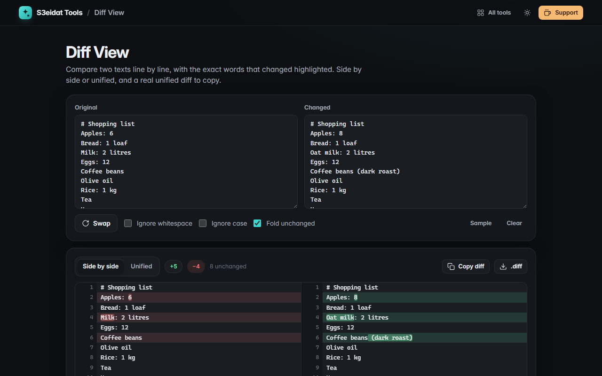

# Diff View

> Compare two texts side by side or as a unified diff, with word-level highlights. Free, private, and it runs entirely in your browser.

### ▶ [Open Diff View](https://s3eidat.github.io/diff-view/)



## Features

- **Line diff** with the Myers algorithm (the same idea behind `git diff`)
- **Word-level highlights** inside changed lines, so you see exactly what was edited
- **Side-by-side** and **unified** views, with line numbers for both texts
- **Ignore whitespace** and **ignore case** options
- **Fold unchanged** runs to 3 lines of context, click to expand them
- Stats: lines added, removed and unchanged; **swap** the two sides in one click
- **Copy or download a standard unified diff** (`---` / `+++` / `@@` hunks with 3 lines of context)
- Works with any language, including Arabic and other right-to-left text

## Privacy

Your texts never leave your device. There is no server, no account, no analytics.
The page ships with a strict Content-Security-Policy (`connect-src 'self'`), so the browser
itself blocks any attempt to send data anywhere.

## Run it yourself

It's plain HTML, CSS and JavaScript with no build step:

```bash
git clone https://github.com/s3eidat/diff-view
cd diff-view
python -m http.server 8000
```

Then open http://localhost:8000.

## Support

If this saved you time, **[buy me a coffee ☕](https://s3eidat.github.io/coffee/)**. It keeps every tool free.

---

Part of **[S3eidat Tools](https://s3eidat.github.io/)**: 100+ free, private tools that run in your browser. MIT licensed.
